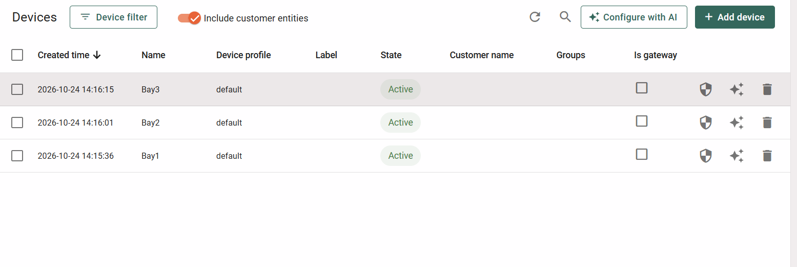
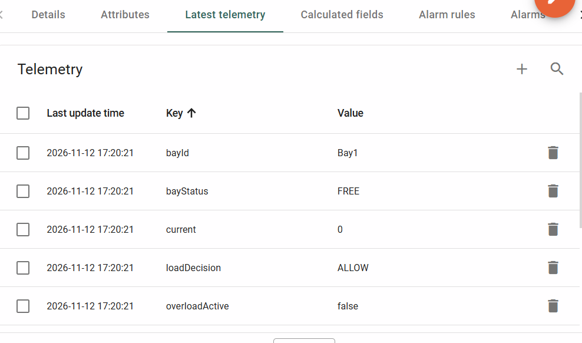
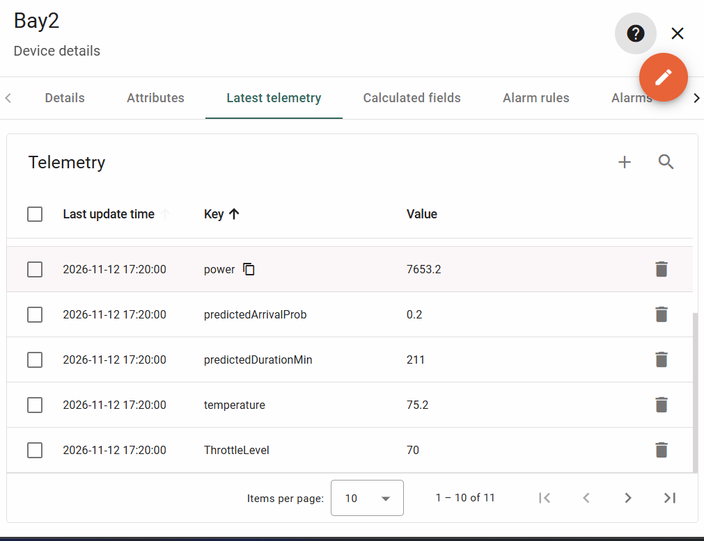
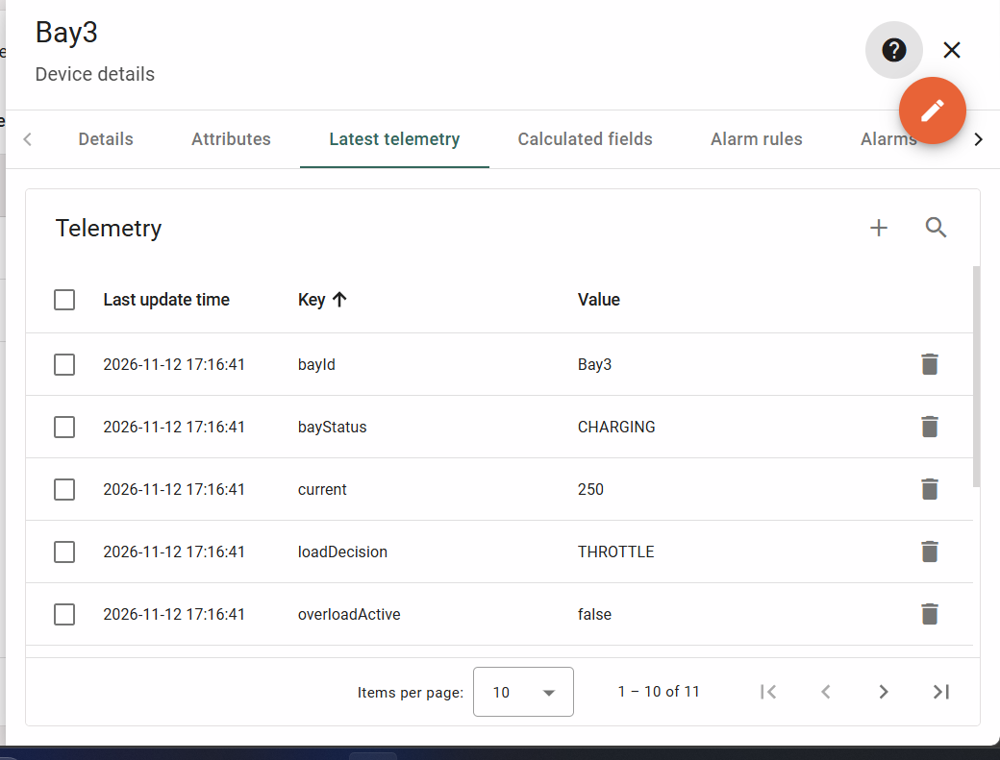
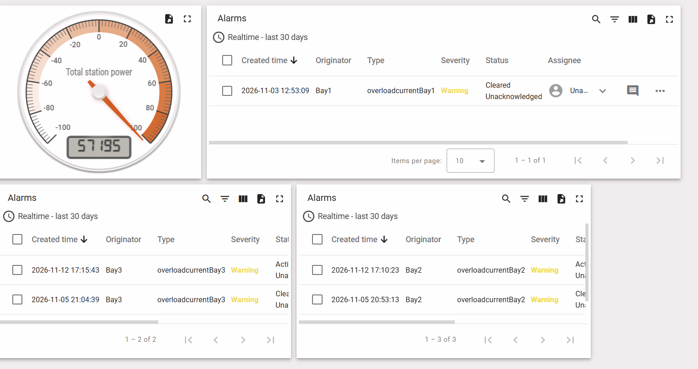
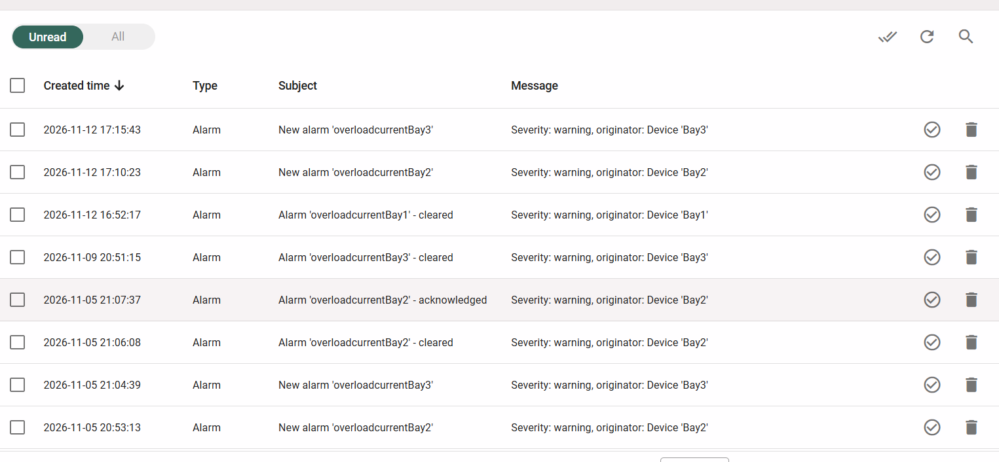
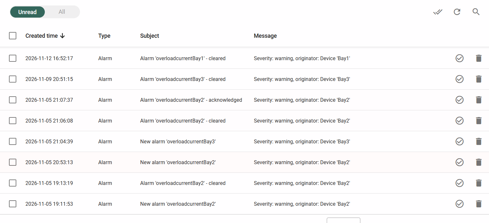
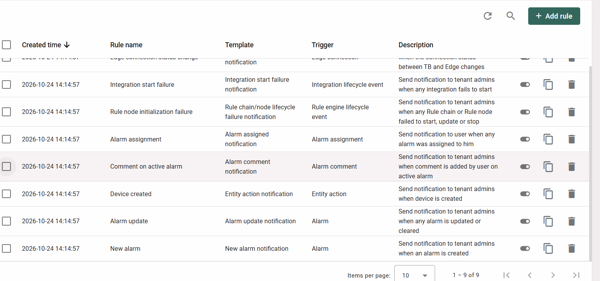
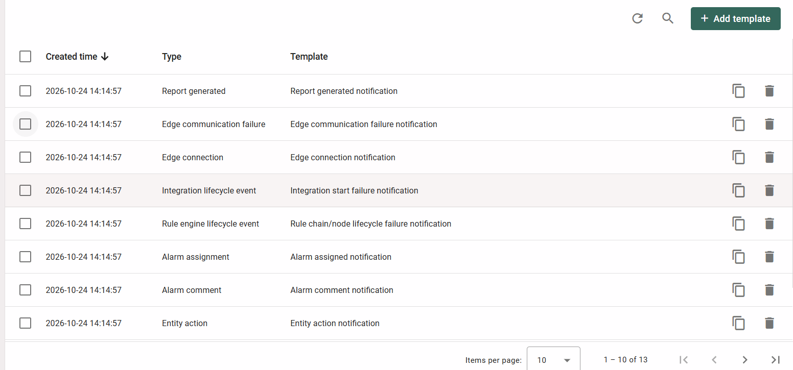
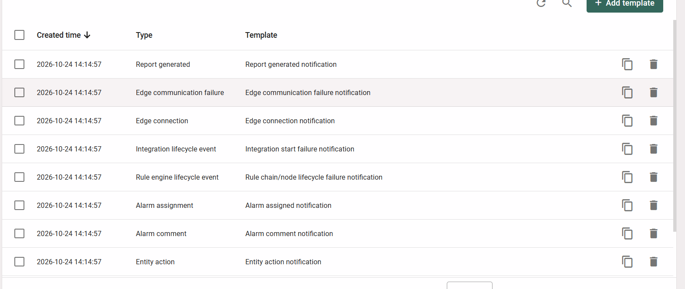

Edge-AI Smart EV Charging Station Optimizer

An ESP32-based Edge AI and IoT Smart EV Charging Station Optimizer designed for intelligent charging bay monitoring, load optimization and remote relay control using ThingsBoard.

1. Project Overview

Electric vehicle charging stations need efficient monitoring and intelligent load management to improve charging operations.

This project develops an ESP32-based smart EV charging station optimizer that monitors charging bay parameters, processes sensor information using Edge AI logic and makes charging-related decisions.

The system communicates with the ThingsBoard IoT platform using MQTT to provide remote monitoring and control.

2. Objectives

- Monitor EV charging bay operating parameters.
- Process sensor data using Edge AI logic.
- Make intelligent charging and load management decisions.
- Monitor charging bay status in real time.
- Enable remote monitoring through ThingsBoard.
- Support remote relay control.

3. Technologies Used

Category| Technology
Microcontroller| ESP32
Programming language| Embedded C++
Development environment| VS Code
Embedded framework| Arduino
Build system| PlatformIO
IoT platform| ThingsBoard
Communication protocol| MQTT
Simulation| Wokwi
Version control| Git and GitHub

4. Hardware and Software Requirements

Hardware components

- ESP32 development board
- Sensors
- Relay module
- LEDs
- Push buttons
- Connecting wires and other required components

Software tools

- Visual Studio Code
- PlatformIO IDE extension
- Wokwi simulator
- ThingsBoard Cloud
- Git and GitHub

5. System Architecture

The project follows this general processing flow:

1. Sensor data is collected by the ESP32.
2. The ESP32 processes the collected information.
3. Edge AI logic evaluates the operating conditions.
4. The optimization logic determines the charging/load decision.
5. MQTT communication sends telemetry to ThingsBoard.
6. ThingsBoard displays the monitored parameters.
7. Remote control commands can be used for relay operation.

6. Key Features

- ESP32-based embedded monitoring.
- Edge AI-based decision processing.
- Charging bay status monitoring.
- Load decision monitoring.
- MQTT-based IoT communication.
- ThingsBoard dashboard integration.
- Remote relay control.
- Modular firmware architecture.

7. Project Structure

Edge-AI-Smart-EV-Charging-Station-Optimizer/
│
├── docs/       # Dashboard screenshots
├── include/    # Header files
├── lib/        # Libraries
├── src/        # Firmware source files
├── test/       # Simulation and test files
├── .gitignore
├── README.md
└── platformio.ini

8. Development and Simulation

The firmware is developed using VS Code and PlatformIO. Wokwi is used for ESP32 simulation and testing.

The system communicates with ThingsBoard through MQTT for telemetry monitoring and remote control.

9. Project Results

## ThingsBoard Dashboard & Monitoring

### Charging Bay Devices

### Bay 1 – Latest Telemetry

### Bay 2 – Latest Telemetry

### Bay 3 – Latest Telemetry

### Overload Alarms

### Notifications – New Alarms

### Notifications – Alarm History

### Notification Rules

### Notification Templates

### Notification Templates Overview

10. Future Improvements

- Improve Edge AI decision accuracy.
- Extend monitoring to multiple charging bays.
- Add advanced charging load prediction.
- Improve energy management and optimization.
- Integrate additional EV charging parameters.

11. Author

Apoorva K C

Electronics and Communication Engineering Student

GitHub: "apoorva-k-c" (https://github.com/apoorva-k-c)

---

Note: This project is developed for educational and demonstration purposes.
